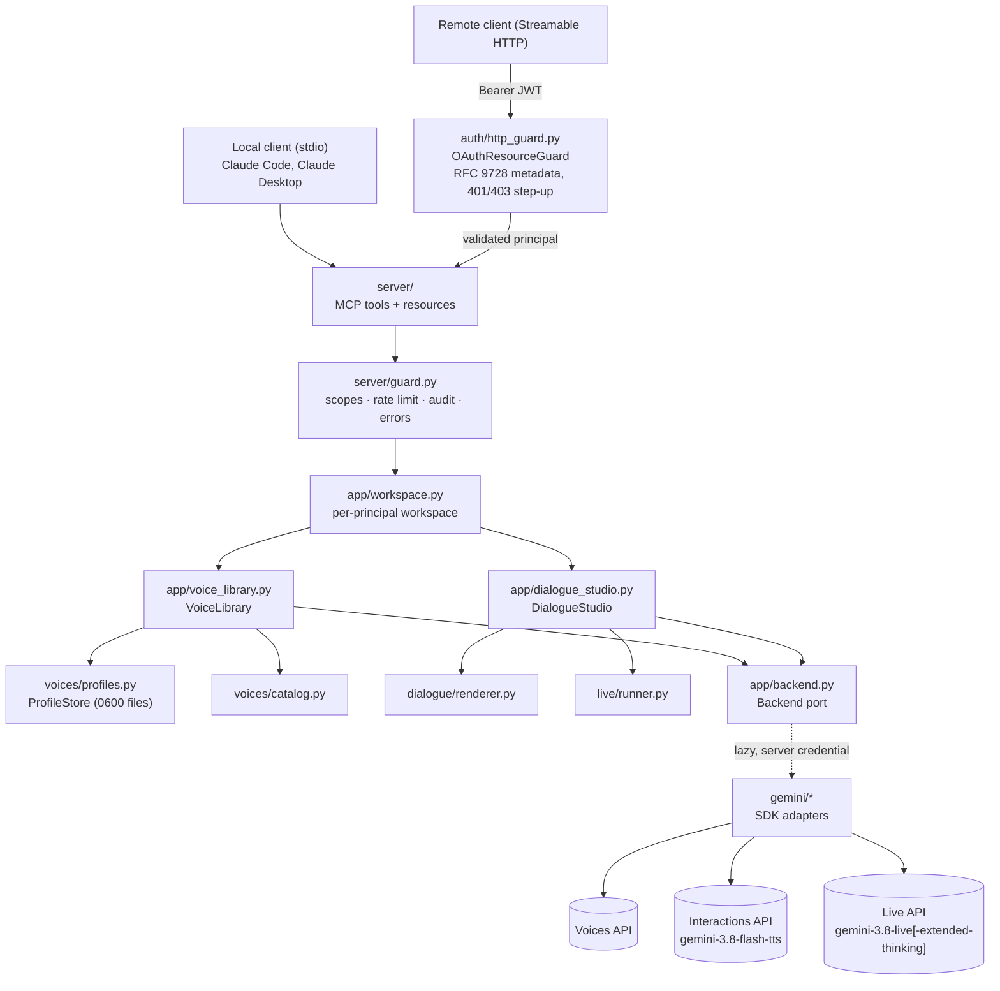
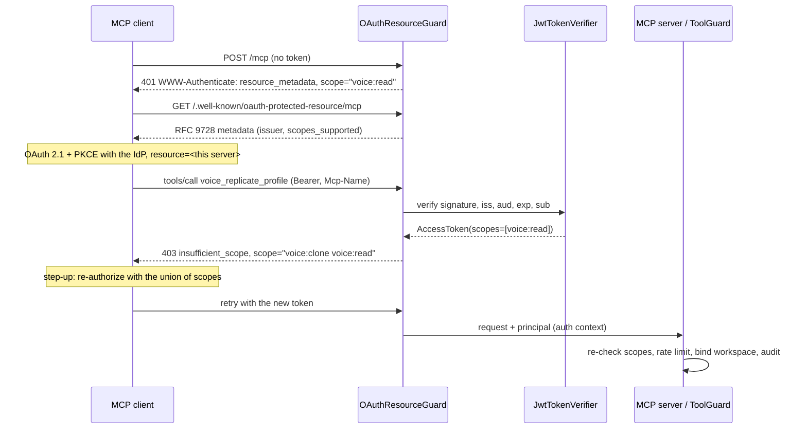
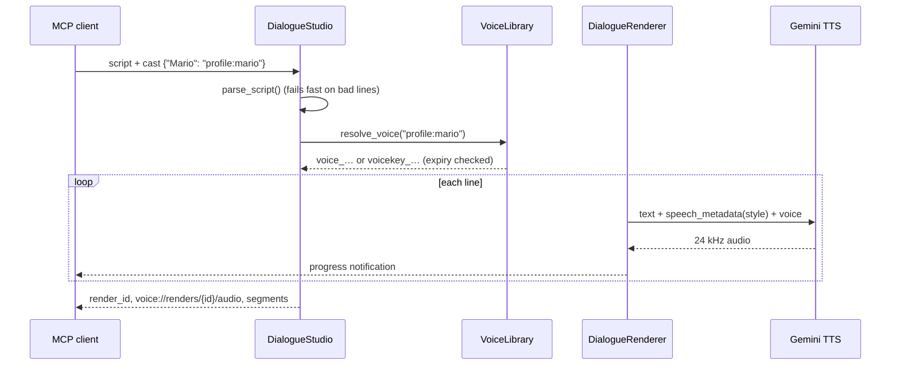
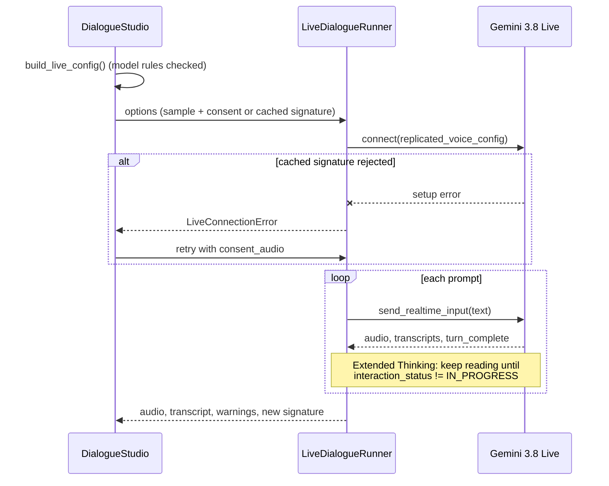

# Architecture

The MCP server uses ports and adapters (clean architecture). The domain and application
layers never import `google-genai`. MCP, OAuth and HTTP concerns live at the edges
(`server/`, `auth/`), so the core rules are unit-tested with in-memory fakes.

## Layers

| Layer | Modules | Depends on |
|---|---|---|
| Domain | `audio/`, `dialogue/`, `voices/`, `live/` | stdlib (plus `Protocol` ports) |
| Application | `app/voice_library.py`, `app/dialogue_studio.py`, `app/workspace.py`, `app/inputs.py`, `app/rate_limit.py`, `app/audit.py`, `app/outputs.py`, `app/backend.py` | domain |
| Adapters | `gemini/*.py`, `app/backend.GeminiBackend` | `google-genai` |
| Auth (HTTP edge) | `auth/scopes.py`, `auth/principal.py`, `auth/jwt_verifier.py`, `auth/http_guard.py`, `auth/config.py` | `mcp`, `pyjwt`, `starlette` |
| Interface | `server/` (`core`, `guard`, `schemas`, `voice_tools`, `dialogue_tools`, `resources`, `composition`, `http`), `__main__.py` | application, auth, `mcp` |

The composition root is `server.composition.create_server`. It chooses the deployment
policy (`ServerOptions`):

| | stdio (local) | HTTP + OAuth (remote) |
|---|---|---|
| Caller | Trusted local user | Validated JWT principal |
| Scope checks | Off | Per tool (and per HTTP request) |
| Workspace | One shared (`VOICE_CREATOR_DATA_DIR`) | One per principal (`principals/<sha256>`) |
| File-path inputs | Allowed (optionally confined) | Disabled; base64 only |
| Server paths in results | Shown | Redacted; use `voice://renders/…` resources |
| Rate limit | Off unless configured | 30 costly calls/min per principal (default) |

## Key flows

### Authorization (HTTP)

### Scripted dialogue (`voice_render_dialogue`)

### Live dialogue (`voice_live_dialogue`)

## Design decisions

- **Two layers of authorization.** The HTTP guard issues spec-compliant `401`/`403`
  step-up challenges, using routing headers or, for older clients, the JSON-RPC body.
  Every tool then re-checks scopes from the validated token, so a spoofed header can
  never grant access.
- **Resource server only.** Tokens come from an external IdP. The server validates
  audience-bound JWTs and never forwards them (no token passthrough).
- **Per-principal workspaces.** Biometric data is partitioned by `sha256(issuer, subject)`
  with owner-only permissions.
- **Remote servers are base64-only.** Tool arguments can be prompt-injected, so a remote
  server never reads caller-supplied server paths.
- **Line-by-line TTS through the Interactions API.** It works for any cast and voice type,
  and delivery direction goes in `speech_metadata`, where it isn't read aloud.
- **Local voice profiles for Live.** Live can't use Voices API IDs yet. Recordings are
  kept locally and sent per session, with a cached consent signature.
- **Lazy Gemini client.** Offline tools work without an API key.
- **No native audio dependencies.** WAV handling and signal checks use only the
  standard library.
