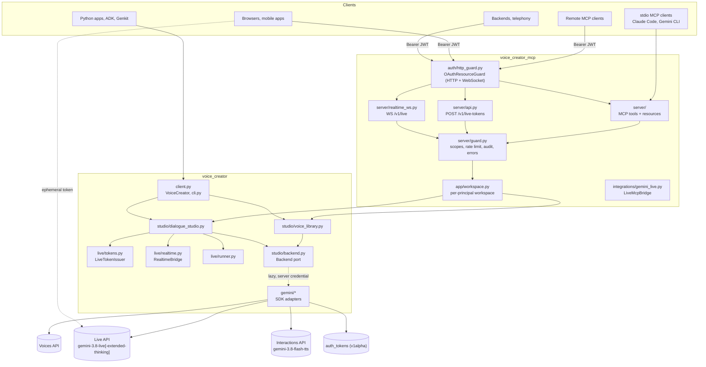
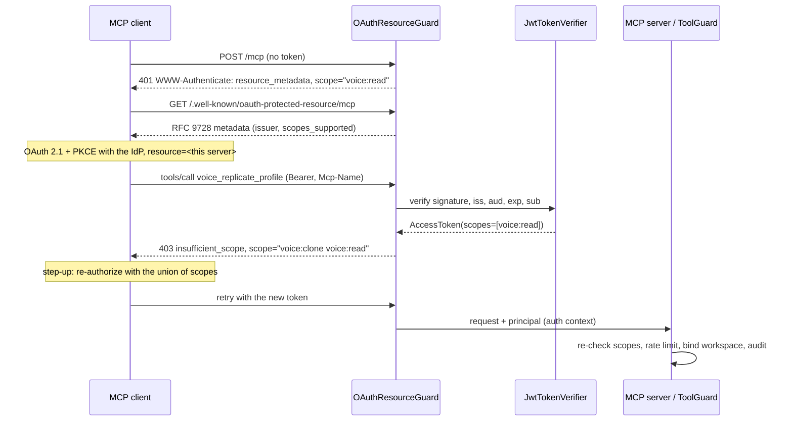
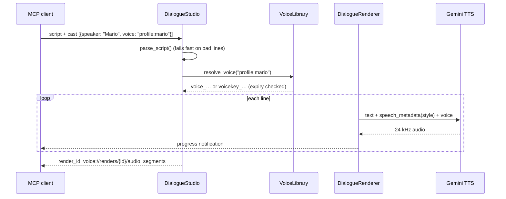
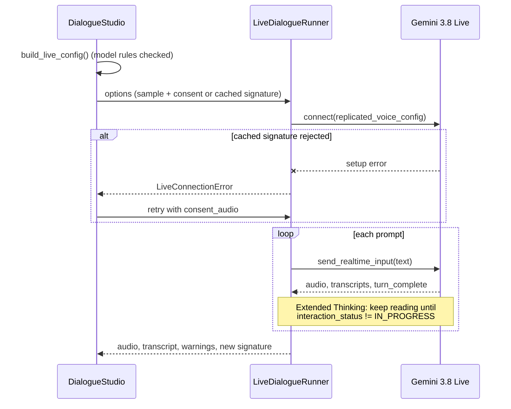
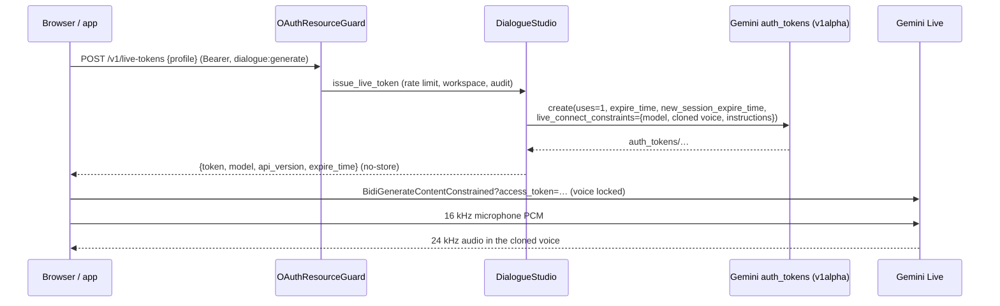
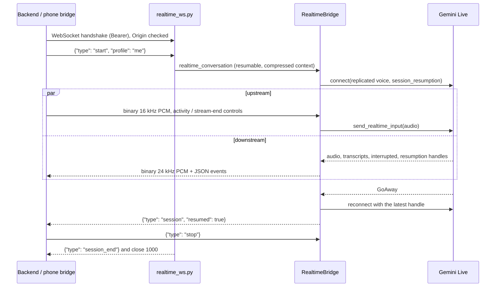

# Architecture

Two packages, one direction of dependency:

- **`voice_creator`** is the voice core: a library, CLI and verifier. It depends only on
  `google-genai`, and a test enforces that it never imports MCP, Starlette, Uvicorn or
  PyJWT.
- **`voice_creator_mcp`** holds the MCP server, the OAuth resource server, the HTTP API
  (`/v1/live-tokens`, `/v1/live`) and the Gemini integrations (`LiveMcpBridge`). It
  depends on the core (the `mcp` extra).

Inside the core, ports and adapters keep `google-genai` at the edge (`gemini/`), so the
domain rules are unit-tested with in-memory fakes.

## Layers

| Layer | Modules | Depends on |
|---|---|---|
| Domain | `voice_creator/{audio,dialogue,voices,live}/` | stdlib (plus `Protocol` ports) |
| Application | `voice_creator/studio/` (`voice_library`, `dialogue_studio`, `outputs`, `backend`), `voice_creator/diagnostics/` | domain |
| Adapters | `voice_creator/gemini/*.py`, `studio/backend.GeminiBackend` | `google-genai` |
| Core interface | `voice_creator/client.py` (`VoiceCreator`), `voice_creator/cli.py` | application |
| MCP application | `voice_creator_mcp/app/` (workspaces, input safety, rate limit, audit) | core |
| Auth (HTTP edge) | `voice_creator_mcp/auth/` (scopes, principal, JWT verification, guard, config) | `mcp`, `pyjwt`, `starlette` |
| MCP interface | `voice_creator_mcp/server/` (`core`, `guard`, `schemas`, `voice_tools`, `dialogue_tools`, `resources`, `api`, `realtime_ws`, `composition`, `http`), `__main__.py` | MCP application, auth, `mcp` |
| Integrations | `voice_creator_mcp/integrations/` (`gemini_live.LiveMcpBridge`, `verification`) | core, `mcp`, `google-genai` |

The composition root is `server.composition.create_components`, which returns the MCP
server and the `ToolGuard` shared by the MCP tools and the HTTP API. It chooses the
deployment policy (`ServerOptions`):

| | stdio (local) | HTTP + OAuth (remote) |
|---|---|---|
| Caller | Trusted local user | Validated JWT principal |
| Scope checks | Off | Per tool (and per HTTP request) |
| Workspace | One shared (`VOICE_CREATOR_DATA_DIR`) | One per principal (`principals/<sha256>`) |
| File-path inputs | Allowed (optionally confined) | Disabled; base64 only |
| Server paths in results | Shown | Redacted; use `voice://renders/…` resources |
| Rate limit | Off unless configured | 30 costly calls/min per principal (default) |

## Key flows

### Authorization (HTTP)

### Scripted dialogue (`voice_render_dialogue`)

### Live dialogue (`voice_live_dialogue`)

### Client-to-server: ephemeral token (`POST /v1/live-tokens`)

### Server-to-server: realtime relay (`WS /v1/live`)

## Design decisions

- **Two layers of authorization.** The HTTP guard issues spec-compliant `401`/`403`
  step-up challenges, using routing headers or, for older clients, the JSON-RPC body.
  Every tool then re-checks scopes from the validated token, so a spoofed header can
  never grant access.
- **Resource server only.** Tokens come from an external IdP. The server validates
  audience-bound JWTs and never forwards them (no token passthrough).
- **Per-principal workspaces.** Biometric data is partitioned by `sha256(issuer, subject)`
  with owner-only permissions.
- **Remote servers are base64-only.** Tool arguments can be prompt-injected, so a remote
  server never reads caller-supplied server paths.
- **Line-by-line TTS through the Interactions API.** It works for any cast and voice type,
  and delivery direction goes in `speech_metadata`, where it isn't read aloud.
- **Local voice profiles for Live.** Live can't use Voices API IDs yet. Recordings are
  kept locally and sent per session, with a cached consent signature.
- **Lazy Gemini client.** Offline tools work without an API key.
- **No native audio dependencies.** WAV handling, signal checks and resampling use only
  the standard library.
- **The core stands alone.** Apps, ADK agents and Genkit flows use `VoiceCreator`
  directly. MCP is one adapter, not the center.
- **Live tokens never go through MCP.** They are credentials, and tool results end up in
  model context and logs, so tokens are only returned by the HTTP API, with `no-store`.
- **The relay is dispatched before Starlette routing.** The MCP app owns the lifespan
  (session manager), so `with_realtime_route` hands `/v1/live` WebSocket scopes to the
  endpoint and everything else to the MCP app. Both sit behind the OAuth guard.
- **Tool declarations keep their JSON Schema.** `parameters_json_schema` plus
  `NON_BLOCKING` for Extended Thinking. The SDK's automatic MCP conversion drops
  `additionalProperties`, so tool inputs avoid free-form maps.
