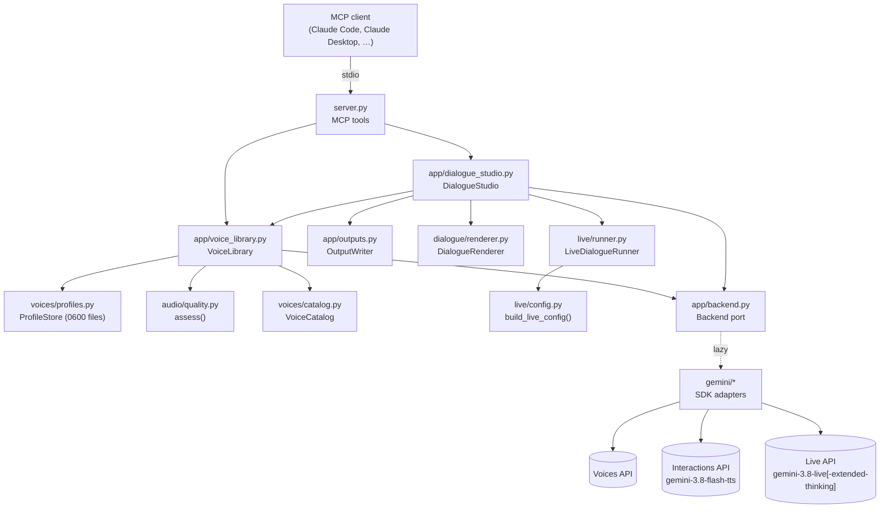
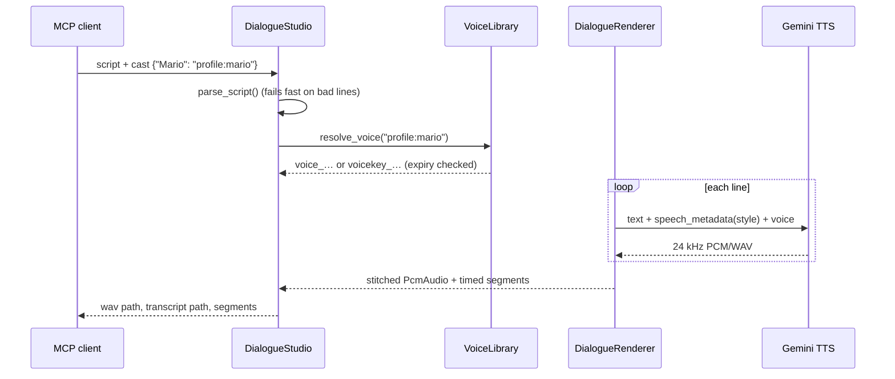
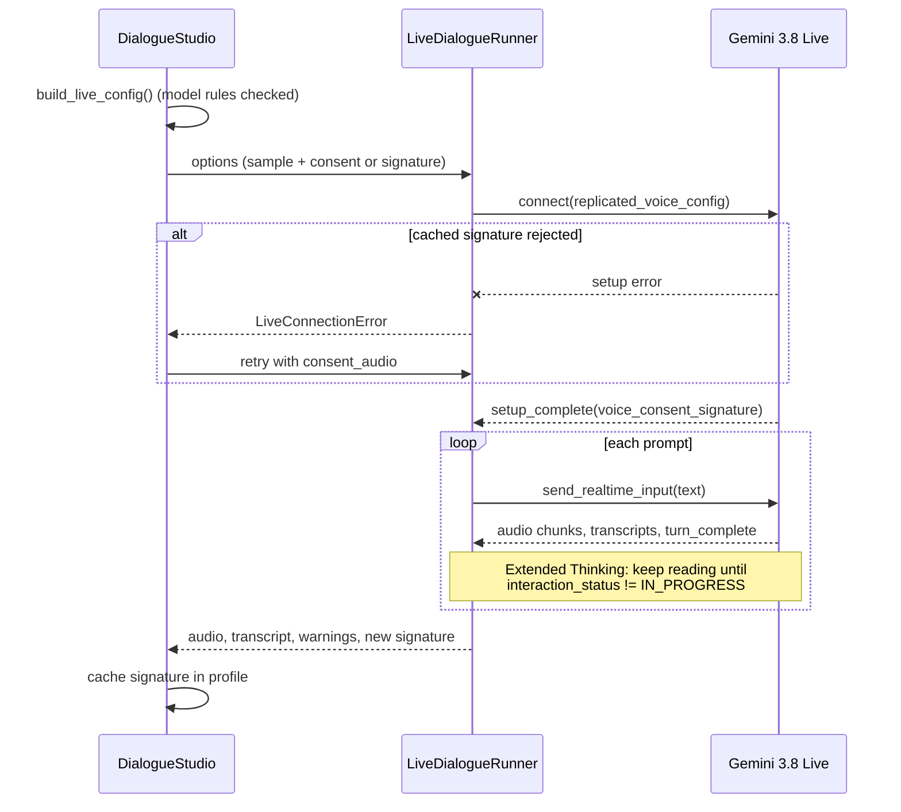

# Architecture

The MCP server uses ports and adapters (clean architecture). The domain and application
layers never import `google-genai` or `mcp`, so every rule is unit-tested with
in-memory fakes. Only thin adapters touch the SDKs.

## Layers

| Layer | Modules | Depends on |
|---|---|---|
| Domain | `audio/`, `dialogue/`, `voices/`, `live/config.py`, `live/instructions.py`, `live/runner.py` | stdlib only (plus `Protocol` ports) |
| Application | `app/voice_library.py`, `app/dialogue_studio.py`, `app/outputs.py`, `app/backend.py` (port) | domain |
| Adapters | `gemini/voices_gateway.py`, `gemini/tts_gateway.py`, `gemini/live_gateway.py`, `app/backend.GeminiBackend` | `google-genai` |
| Interface | `server.py`, `__main__.py` | application, `mcp` |

Ports are `typing.Protocol`s: `VoicesGateway`, `SpeechSynthesizer`, `LiveConnector` /
`LiveSession`, and `Backend`. The composition root, `server.create_server`, wires the
Gemini adapters. Tests wire `tests/fakes.py`.

## Key flows

### Scripted dialogue (`render_dialogue`)

### Live dialogue (`live_dialogue`)

## Design decisions

- **Line-by-line TTS** instead of single-request multi-speaker: it works for any number
  of speakers and any voice type, gives exact segment timings, and limits long-form drift.
- **Interactions API for TTS**: 3.8 TTS takes delivery direction as a `speech_metadata`
  annotation. Putting direction in `generate_content` text would get it read aloud.
- **Local voice profiles**: Live can't use Voices API IDs yet, so the sample and consent
  recordings are kept locally with owner-only permissions and sent per session.
- **Consent-signature cache with fallback**: lower latency on repeat sessions, with
  automatic recovery when the signature expires.
- **Lazy Gemini client**: offline tools work without an API key, and Gemini tools report
  a clear configuration error.
- **No native audio dependencies**: WAV handling and signal checks use only the standard
  library.
